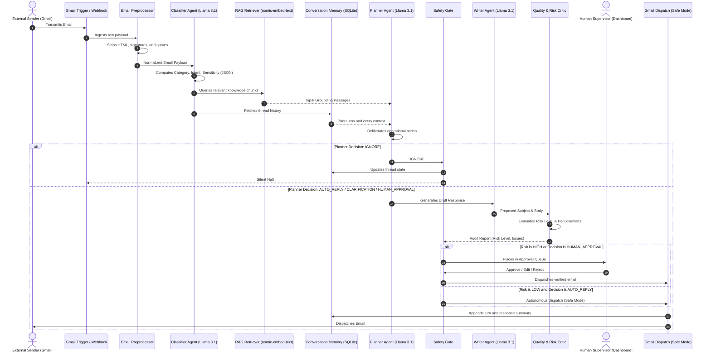
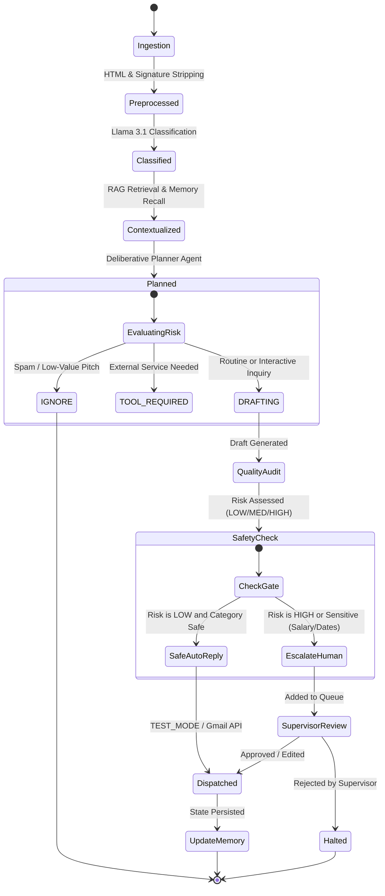

# AgentMail AI - Technical System Architecture Specification

## 1. Architectural Overview
AgentMail AI adopts a **Decoupled Multi-Agent Cognitive Architecture** optimized for local execution on Windows. The system separates classification, retrieval, memory recall, deliberative planning, draft generation, and safety verification into specialized, single-responsibility modules.

---

## 2. End-to-End Sequence Diagram



---

## 3. Finite State Machine (FSM) Decision Lifecycle



---

## 4. RAG Pipeline Architecture

```text
┌──────────────────────────┐
│   knowledge_base/        │
│   ├── profile/           │
│   ├── resume/            │
│   ├── education/         │
│   ├── skills/            │
│   ├── projects/          │
│   ├── internships/       │
│   ├── professional/      │
│   └── response_rules/    │
└────────────┬─────────────┘
             │
             ▼
┌──────────────────────────┐
│ Semantic Chunking Engine │ (Max 150 words per cohesive block)
└────────────┬─────────────┘
             │
             ▼
┌──────────────────────────┐
│ nomic-embed-text (Ollama)│ (Generates 768-dim vector)
└────────────┬─────────────┘
             │
             ▼
┌──────────────────────────┐
│ SQLite rag_chunks Table  │ (Stores chunk text + embedding JSON)
└────────────┬─────────────┘
             │ Cosine Similarity Search
             ▼
┌──────────────────────────┐
│ Top-2 Grounding Chunks   │ -> Injected into Planner, Writer & Critic Prompts
└──────────────────────────┘
```

---

## 5. Security & Boundary Isolation
1. **Untrusted Email Demarcation**: Email contents are framed inside isolated triple-quoted blocks with prompt-injection control filtering.
2. **Environment Variable Protection**: All credentials (`.env`) are kept out of frontend code.
3. **Safe Dispatch Switch**: `TEST_MODE=true` guarantees that during development, tests, and viva examinations, no emails can be dispatched to real third parties without explicit authorization.
